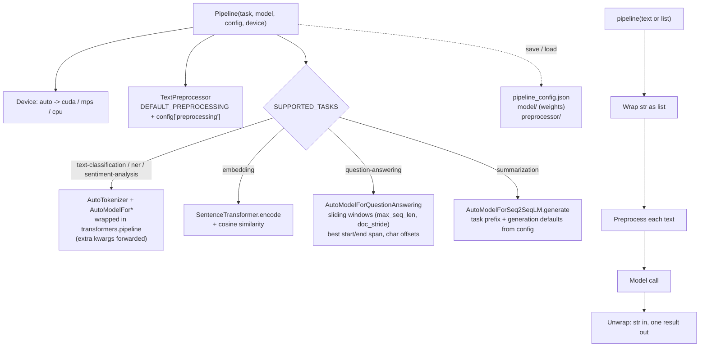

<div align="center">

# Lingo NLP Toolkit

**One `Pipeline` API for sentiment, NER, classification, embeddings, question answering and summarization on Hugging Face models, plus spaCy/NLTK text preprocessing.**

[](https://pypi.org/project/lingo-nlp-toolkit/)
[](https://pypi.org/project/lingo-nlp-toolkit/)
[](https://pepy.tech/projects/lingo-nlp-toolkit)
[](https://github.com/irfanalidv/lingo-nlp-toolkit/actions/workflows/tests.yml)
[](https://github.com/irfanalidv/lingo-nlp-toolkit/actions/workflows/codeql.yml)
[](https://github.com/irfanalidv/lingo-nlp-toolkit/blob/main/LICENSE)
[](https://github.com/astral-sh/ruff)
[](https://mypy-lang.org/)
[](https://github.com/irfanalidv/lingo-nlp-toolkit/blob/main/CONTRIBUTING.md)

</div>

## Why Lingo

Each NLP task in the Hugging Face ecosystem comes with its own loading code, input format and
return shape, and transformers 5 removed the ready-made question-answering and summarization
pipelines. Lingo puts six common tasks behind one `Pipeline(task, model)` call that accepts a
string or a list, returns one result per input, picks the device for you, and keeps working on
transformers 4.x and 5.x. Classic preprocessing (normalisation, stopwords, lemmatisation,
readability) lives in the same package, and every pipeline can be saved, reloaded offline, or run
from the `lingo` CLI.

## Features

| | |
| --- | --- |
| **Six tasks, one API** | `text-classification`, `ner`, `sentiment-analysis`, `embedding`, `question-answering`, `summarization`. |
| **Any Hub model** | Pass a model id or local path; extra keyword arguments go to the Hugging Face pipeline (for example `aggregation_strategy="first"` for NER). |
| **Predictable shapes** | A string in gives one result out; a list in gives a list out; `batch_predict` for large inputs. |
| **transformers 4 and 5** | QA (sliding windows over long contexts, character offsets) and summarization are implemented on the model classes directly. |
| **Device selection** | `device="auto"` picks CUDA, Apple MPS or CPU. |
| **Preprocessing** | Unicode/whitespace normalisation, contractions, slang, punctuation/number removal, stopwords, WordNet lemmatisation, Porter stemming. Pipelines only normalise by default, so cased models keep their casing. |
| **Utilities** | Classification and NER metrics, Flesch readability, chunking with overlap, batching. |
| **Save, load, CLI** | `pipeline.save(dir)` / `Pipeline.load(dir)` restore weights and preprocessing offline; `lingo run <task>` from the shell. |
| **Typed** | Ships `py.typed`; mypy-clean; typed exceptions in `lingo.exceptions`. |

## Install

```bash
pip install lingo-nlp-toolkit
# or
uv pip install lingo-nlp-toolkit
```

Requires Python 3.10+. PyTorch is a dependency; on CPU-only machines you can install the smaller
CPU wheel first with `pip install torch --index-url https://download.pytorch.org/whl/cpu`.

| Extra | Adds |
| --- | --- |
| `[api]` | FastAPI and uvicorn, for serving a pipeline |
| `[examples]` | pandas |
| `[full]` | api + examples + document and visualisation helpers |
| `[gpu]` | torchvision, torchaudio |
| `[dev]` | pytest, pytest-cov, ruff, mypy, pre-commit, build, twine |

Models are downloaded from the Hugging Face Hub and cached the first time they are used. NLTK
data used by `TextPreprocessor` is fetched automatically on first use. `lingo setup` downloads
NLTK data, the spaCy `en_core_web_sm` model and four common models up front.

## Quickstart

Needs network on the first run (downloads about 500 MB per model); later runs work offline.

```python
from lingo import Pipeline

sentiment = Pipeline(task="sentiment-analysis", model="cardiffnlp/twitter-roberta-base-sentiment-latest")
print(sentiment("I absolutely love the new update!"))
# {'label': 'positive', 'score': 0.989...}

ner = Pipeline(task="ner", model="dslim/bert-base-NER", aggregation_strategy="first")
for entity in ner("Tim Cook announced the new iPhone at Apple Park in Cupertino."):
    print(entity["word"], entity["entity_group"], round(entity["score"], 2))
# Tim Cook PER 1.0 / iPhone MISC 0.98 / Apple Park LOC 1.0 / Cupertino LOC 1.0

qa = Pipeline(task="question-answering", model="deepset/roberta-base-squad2")
print(qa(question="Who created Python?",
         context="Python was created by Guido van Rossum and first released in 1991."))
# {'score': 0.989..., 'start': 22, 'end': 38, 'answer': 'Guido van Rossum'}
```

The outputs above are from a run on transformers 5.22; scores vary slightly across versions and
devices.

From the shell:

```bash
lingo run sentiment-analysis --model cardiffnlp/twitter-roberta-base-sentiment-latest --text "I love this product!"
# {"label": "positive", "score": 0.984...}
lingo run question-answering --model deepset/roberta-base-squad2 \
  --question "Who created Python?" --text "Python was created by Guido van Rossum in 1991."
# {"score": 0.977..., "start": 22, "end": 38, "answer": "Guido van Rossum"}
```

## How it works



Design decisions:

- **Minimal default preprocessing.** Pipelines normalise Unicode and whitespace only; lowercasing
  or punctuation removal before a transformer hurts cased models (most NER models), so those are
  opt-in via `config={"preprocessing": {...}}`.
- **Own QA and summarization loops.** Rather than depending on pipelines that transformers 5
  removed, QA scores every valid (start, end) span inside each context window and returns the
  best one with character offsets; summarization calls `generate` with the model's own
  task-specific defaults (for example T5's `"summarize: "` prefix).
- **Always a list internally.** Every model call works on lists and the `Pipeline` unwraps single
  inputs, which keeps batching and return types consistent across tasks.
- **Offline-friendly persistence.** `Pipeline.load` prefers the saved weights over the Hub id, and
  `device=` can override the saved device when moving between machines.

## Use cases and recipes

| Script | What it shows | Needs |
| --- | --- | --- |
| [`text_toolkit_offline.py`](https://github.com/irfanalidv/lingo-nlp-toolkit/blob/main/examples/text_toolkit_offline.py) | Review cleaning, lemmas, Flesch readability, chunking and classifier metrics. | No model; NLTK data on first run |
| [`support_ticket_triage.py`](https://github.com/irfanalidv/lingo-nlp-toolkit/blob/main/examples/support_ticket_triage.py) | Sentiment + NER to prioritise angry tickets that name companies or places. | Two models (~930 MB) on first run |
| [`semantic_faq_search.py`](https://github.com/irfanalidv/lingo-nlp-toolkit/blob/main/examples/semantic_faq_search.py) | Map free-text questions to FAQ entries with embeddings and a hand-off threshold. | all-MiniLM-L6-v2 (~90 MB) |
| [`document_qa_and_summary.py`](https://github.com/irfanalidv/lingo-nlp-toolkit/blob/main/examples/document_qa_and_summary.py) | Answer questions about a policy with exact source spans, then summarise it. | roberta-base-squad2 + bart-large-cnn (~2.1 GB) |

```bash
git clone https://github.com/irfanalidv/lingo-nlp-toolkit && cd lingo-nlp-toolkit
pip install -e .
python examples/text_toolkit_offline.py
```

<details>
<summary><b>More snippets: embeddings, summarization, preprocessing, metrics</b></summary>

```python
from lingo import Pipeline, TextPreprocessor
from lingo.utils import evaluate_classification

emb = Pipeline(task="embedding", model="sentence-transformers/all-MiniLM-L6-v2")
vector = emb("The cat is on the mat.")                      # list of 384 floats
emb.model.similarity("The cat is on the mat.", "A cat is sitting on the mat.")  # 0.907
emb.model.similarity("The cat is on the mat.", "The weather is beautiful today.")  # -0.002

summarizer = Pipeline(task="summarization", model="facebook/bart-large-cnn")
summarizer(long_text, max_length=60, min_length=20)["summary_text"]

pre = TextPreprocessor(config={
    "use_spacy": False, "lowercase": True, "expand_contractions": True,
    "remove_punctuation": True, "remove_stopwords": True, "lemmatize": True,
})
steps = pre.get_preprocessing_pipeline("The foxes weren't jumping over the lazy dogs!")
steps["cleaned"]                                     # 'the foxes were not jumping over the lazy dogs'
pre.lemmatize_tokens(steps["words_no_stopwords"])    # ['fox', 'jumping', 'lazy', 'dog']

evaluate_classification(["pos", "neg", "pos"], ["pos", "neg", "neg"])["accuracy"]  # 0.666...
```

</details>

<details>
<summary><b>Serving a pipeline with FastAPI</b></summary>

Requires `pip install "lingo-nlp-toolkit[api]"`.

```python
from fastapi import FastAPI

from lingo import Pipeline

app = FastAPI()
pipeline = Pipeline.load("./saved_pipeline", device="cpu")


@app.post("/analyze")
def analyze(text: str) -> dict:
    return {"result": pipeline(text)}
```

Run with `uvicorn main:app`. Hugging Face pipelines are not guaranteed to be thread-safe; keep one
pipeline per worker process.

</details>

## Configuration

**`Pipeline` arguments**

| Argument | Default | Meaning |
| --- | --- | --- |
| `task` | required | One of the six task names. |
| `model` | required | Hub id or local directory. |
| `device` | `"auto"` | `"auto"`, `"cpu"`, `"cuda"` or `"mps"`. |
| `cache_dir` | HF default | Where downloaded models are cached. |
| `config["preprocessing"]` | normalise Unicode + whitespace only | Any `TextPreprocessor` option below. |
| `**kwargs` | | Forwarded to the Hugging Face pipeline (classification, NER, sentiment). |

**`TextPreprocessor` options** (standalone defaults; `Pipeline` overrides `lowercase` and
`use_spacy` to `False`)

| Option | Default | Option | Default |
| --- | --- | --- | --- |
| `normalize_unicode` (NFC) | `True` | `expand_contractions` | `False` |
| `lowercase` | `True` | `expand_slang` | `False` |
| `remove_punctuation` | `False` | `remove_stopwords` | `False` |
| `remove_numbers` | `False` | `lemmatize` (WordNet) | `False` |
| `remove_special_chars` | `False` | `stem` (Porter) | `False` |
| `remove_extra_whitespace` | `True` | `use_spacy` / `spacy_model` | `True` / `"en_core_web_sm"` |

`correct_spelling` and `use_subword_tokenization` are accepted but not implemented (the second
logs a warning).

**Environment variables** (read by Hugging Face libraries)

| Variable | Effect |
| --- | --- |
| `HF_HOME` | Root of the Hugging Face cache. |
| `HF_HUB_OFFLINE=1` | Never contact the Hub; use cached models only. |
| `HF_TOKEN` | Access token for gated or private models. |

## API overview

| Object | What it does |
| --- | --- |
| `Pipeline(task, model, config=None, device="auto", cache_dir=None, **kwargs)` | Unified entry point; call with a string or list. QA uses `nlp(question=..., context=...)`. |
| `Pipeline.batch_predict(texts, batch_size=32)` | Batched inference; always returns a list. |
| `Pipeline.save(path)` / `Pipeline.load(path, device=None)` | Persist and restore weights, preprocessing and config. |
| `Pipeline.get_info()` | Task, model, device and config. |
| `TextPreprocessor(config, language="english")` | Cleaning, tokenisation, stopwords, lemmatisation, stemming; `get_preprocessing_pipeline(text)` returns every stage. |
| `TextClassifier`, `NERModel`, `SentimentAnalyzer`, `EmbeddingModel`, `QuestionAnsweringModel`, `SummarizationModel` | Task wrappers used by `Pipeline`; usable directly. `EmbeddingModel.similarity(a, b)` gives cosine similarity. |
| `lingo.utils` | `evaluate_classification`, `evaluate_ner`, `get_text_statistics`, `chunk_text`, `clean_text`, `batch_texts`, `get_available_models`, `download_model`, `download_file`, `load_model`, `save_model`. |
| `lingo.exceptions` | `LingoError`, `UnsupportedTaskError`, `InvalidInputError` (both also `ValueError`). |
| `lingo` CLI | `lingo run <task>`, `lingo list-models`, `lingo download-model`, `lingo setup`, `lingo --version`. |

## Research and references

- Extractive QA span selection over overlapping windows follows the SQuAD fine-tuning setup in
  Devlin, J., Chang, M.-W., Lee, K. & Toutanova, K. (2019). BERT: Pre-training of Deep
  Bidirectional Transformers for Language Understanding. *NAACL-HLT 2019*.
- The embedding task uses the sentence-transformers library: Reimers, N. & Gurevych, I. (2019).
  Sentence-BERT: Sentence Embeddings using Siamese BERT-Networks. *EMNLP-IJCNLP 2019*.
- `get_text_statistics` computes the Flesch Reading Ease score (with an approximate syllable
  count): Flesch, R. (1948). A new readability yardstick. *Journal of Applied Psychology*, 32(3),
  221-233.
- Stemming uses NLTK's Porter stemmer: Porter, M. F. (1980). An algorithm for suffix stripping.
  *Program*, 14(3), 130-137.

## When to use it

Lingo suits scripts, notebooks and small services that need several standard NLP tasks with one
consistent interface and offline save/load. If you need a single task with full control over
batching, quantisation or serving, `transformers.pipeline` (or a dedicated inference server) is
lighter. For linguistic annotation pipelines (parsing, rule-based matching), use spaCy directly;
Lingo only uses it for tokenisation.

## Roadmap

- Make spaCy and NLTK optional extras to slim the default install.
- Implement `load_model` for standalone model directories (currently `NotImplementedError`).
- Batched QA across several question/context pairs.

## Contributing, security, citation, license

- Contributing: see [CONTRIBUTING.md](https://github.com/irfanalidv/lingo-nlp-toolkit/blob/main/CONTRIBUTING.md)
  (`ruff`, `mypy` and `pytest --cov` must pass; tests run offline with faked models).
- Security: report vulnerabilities as described in
  [SECURITY.md](https://github.com/irfanalidv/lingo-nlp-toolkit/blob/main/SECURITY.md).
- Changelog: [CHANGELOG.md](https://github.com/irfanalidv/lingo-nlp-toolkit/blob/main/CHANGELOG.md).
- Citation: cite the software via
  [CITATION.cff](https://github.com/irfanalidv/lingo-nlp-toolkit/blob/main/CITATION.cff) (GitHub's
  "Cite this repository" button reads it).
- License: MIT, see [LICENSE](https://github.com/irfanalidv/lingo-nlp-toolkit/blob/main/LICENSE).
